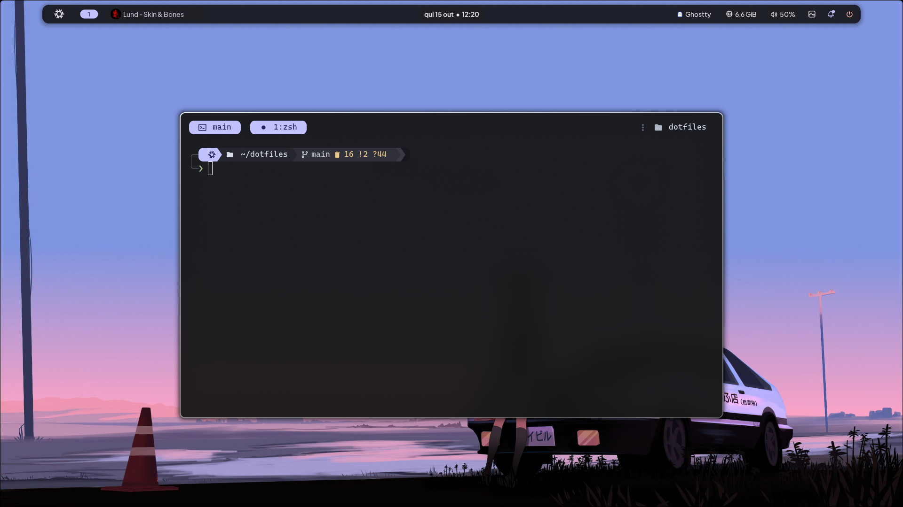
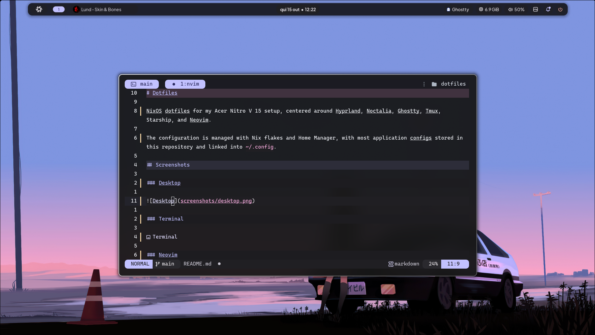

# Dotfiles

My NixOS dotfiles for an Acer Nitro V 15, built around Hyprland, Noctalia, Ghostty, Tmux, Starship, and Neovim.

The setup is managed with Nix flakes and Home Manager, with most application configs stored in this repository and linked into `~/.config` or home files, like `~/.tmux.conf` .

## Stack

- **NixOS + Home Manager**
- **Hyprland**
- **Noctalia**
- **Ghostty**
- **Tmux**
- **Starship**
- **Neovim**
- **Zsh**

## Theme

The desktop uses Noctalia for dynamic wallpaper-based accent colors.

To keep the terminal environment consistent across very different wallpapers, the setup uses a mixed approach:

- Noctalia controls the main desktop theme
- Tmux and Starship use the Noctalia accent color
- Neovim uses the dynamic Base16 palette
- Ghostty keeps a neutral dark background
- Terminal surfaces stay mostly graphite/neutral to avoid excessive color tinting

This keeps the environment dynamic without letting red, green, or blue wallpapers dominate the entire terminal UI.

## Screenshots

### Desktop



### Neovim



## Structure

```text
nix/          NixOS and Home Manager
hyprland/     Hyprland configuration
noctalia/     Noctalia shell and theming
ghostty/      Ghostty configuration
starship/     Starship prompt
tmux/         Tmux configuration
nvim/         Neovim configuration
zsh/          Zsh configuration
scripts/      Helper scripts
wallpapers/   Wallpapers
```

## Installation

Clone the repository:

```bash
git clone git@github.com:vinialx/dotfiles.git ~/dotfiles
```

Apply the system configuration:

```bash
sudo nixos-rebuild switch --flake ~/dotfiles/nix#nixos
```

Home Manager is integrated into the flake and handles user packages and configuration links.

## Useful Commands

Rebuild the system:

```bash
nxupd
```

Edit home.nix:

```bash
nxcfg
```

Clear old Nix generations:

```bash
nxclrd
```

## Hardware

Current machine:

```text
Acer Nitro V 15
Intel Core i5-13420H
NVIDIA GeForce RTX 4060
```

Some hardware-specific settings may need adjustment on other machines.

## Author

**Vinialx**

GitHub: `@vinialx`
